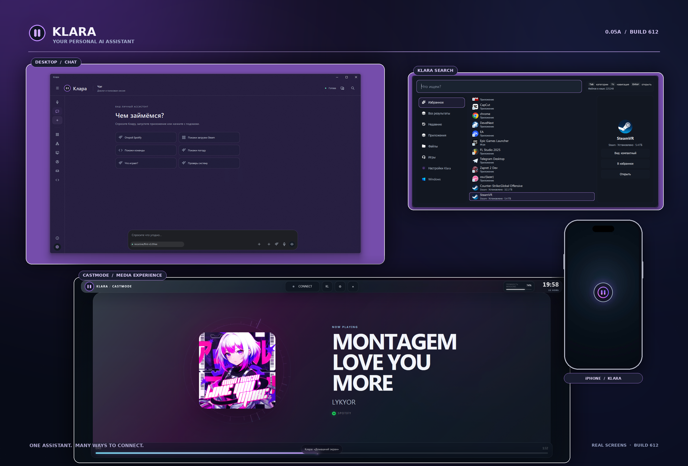
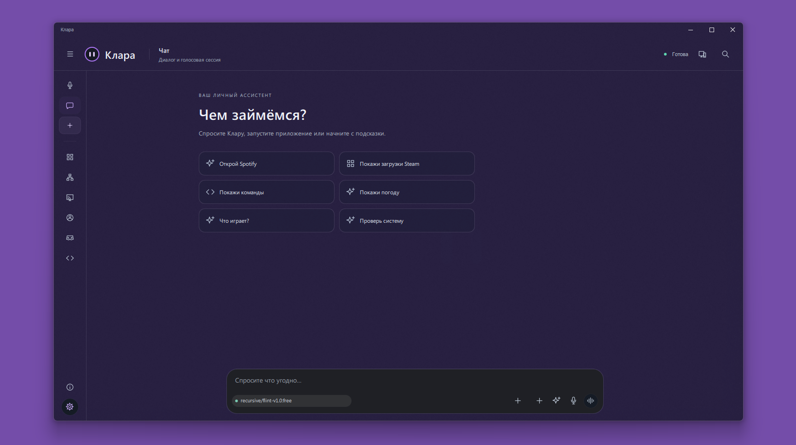
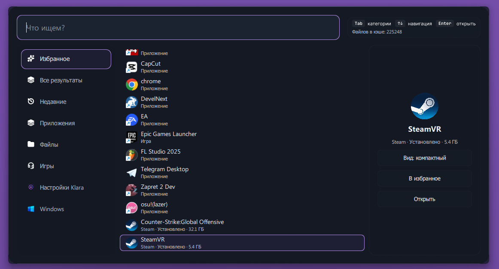
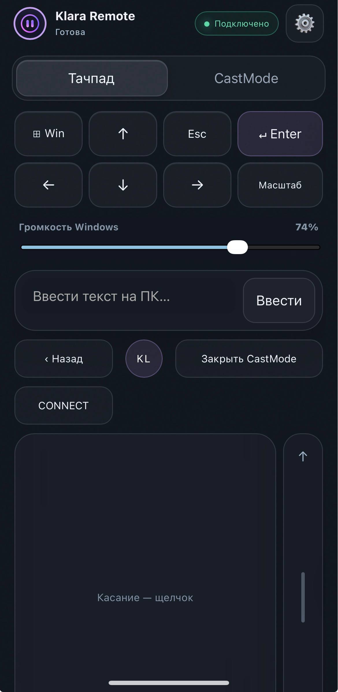
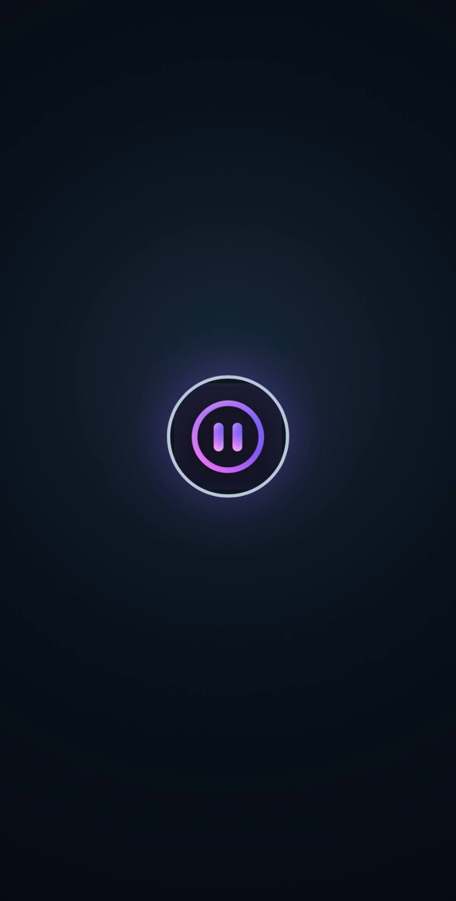
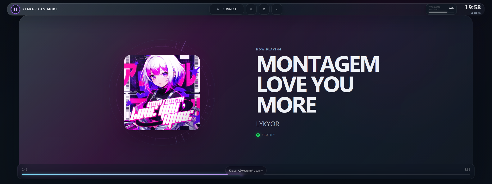

<div align="center">
  
  <h1>Klara</h1>
  <p><strong>Персональный AI-ассистент для Windows</strong></p>
  <p>Чат · Голос · Поиск · CODE / AGENT · CONNECT · CastMode</p>
  <p>
    
    
    
    
  </p>
</div>

---

Klara объединяет AI-общение, голосовое взаимодействие, инструменты Windows и самостоятельные подсистемы — от локального поиска и рабочего AI-агента до подключения устройств и медиа-интерфейса CastMode.

> **Текущий выпуск:** `0.05A` · **Build:** `612` · **Klara Core:** `0.02A`  
> Build 612 — тестовая сборка. Некоторые возможности требуют дополнительной настройки, а отдельные направления разработки остаются экспериментальными.

## Навигация

- [Возможности](#возможности)
- [Галерея](#галерея)
- [Архитектура](#архитектура)
- [Установка](#установка)
- [Известные ограничения](#известные-ограничения)
- [Обратная связь](#обратная-связь)
- [Лицензия](#лицензия)

## Возможности

### AI-чат и голос

- Чат с историей, отдельными сессиями, потоковой выдачей ответов и отменой запроса.
- Локальная языковая модель через **Ollama**; установщик подготавливает `gemma3:4b`.
- В коде предусмотрена поддержка OpenAI-совместимых провайдеров; доступность удалённых API зависит от конфигурации и текущей сборки.
- Распознавание речи через **Faster-Whisper** с **Vosk** в качестве резервного варианта.
- Озвучивание ответов через доступные движки, включая Silero и дополнительный **Qwen3-TTS**.
- Отдельные процессы для части голосовых задач.

### CODE / AGENT

Рабочая среда AI-агента для локальных проектов. Инструменты охватывают работу с файлами, поиск по проекту, анализ структуры и импортов, просмотр Git-состояния, запуск команд и тестов, а также операции сборки.

Инструменты разделены по уровням разрешений. Перед подтверждением операций, которые изменяют файлы или запускают команды, проверяйте, что именно будет выполнено.

### Klara Search

Самостоятельный поисковый интерфейс и индексатор. Используется локальный индекс **SQLite / FTS5**, поиск по файлам и приложениям, а также источники, связанные с установленными играми и системными элементами Windows. В интерфейсе предусмотрены категории, избранное, недавние результаты и сведения о выбранном элементе.

### CONNECT / Continuity

Подсистема связи устройств в локальной сети:

- обнаружение устройств и создание доверенной пары;
- передача активности (handoff) и обмен поддерживаемым состоянием;
- синхронизация поддерживаемых настроек;
- защищённое хранение данных привязки и управление разрешениями;
- отдельная серверная часть Continuity для соответствующих сценариев.

Мобильная поддержка текущего выпуска ориентирована на **iPhone**. Поддержка Android в этой версии не заявлена. Для локального подключения устройства должны находиться в совместимой сети; доступность функций зависит от конфигурации и выданных разрешений.

### CastMode

Отдельная медиа-подсистема с собственным интерфейсом, аудиодвижком и веб-пультом. В составе проекта предусмотрена работа с медиасессиями Windows, информацией о воспроизводимом треке, обложками и управлением воспроизведением.

В демонстрационном кадре CastMode оставлена небольшая авторская пасхалка — **MONTAGEM LOVE YOU MORE**.

### Команды, Windows и виджеты

- Встроенные и пользовательские команды.
- Глобальные горячие клавиши.
- Управление окнами, приложениями, системными настройками и мультимедиа.
- Управление громкостью отдельных приложений.
- Виджеты заметок, таймеров, погоды и системной информации.

Набор доступных действий зависит от версии Windows, установленных приложений, прав процесса и настроек пользователя.

### Память, контекст и автоматизация

В Klara Core выделены отдельные сервисы для хранения и поиска пользовательских фактов, сбора разрешённого контекста рабочего стола, режимов присутствия, событий, автоматизации и журнала действий. Необязательные источники контекста и удалённые действия зависят от разрешений пользователя.

### Аватар

В проекте есть runtime-ресурсы Live2D, модели и анимационные материалы, а также экспериментальные инструменты подготовки 3D-модели, рига и анимации. 3D-направление пока не следует считать завершённым.

## Галерея

Все изображения ниже — реальные скриншоты и демонстрационные материалы Klara Build 612. Общая композиция вверху страницы показывает основные экраны вместе; ниже каждый раздел представлен отдельно.

### Главное окно

Основной интерфейс Klara на Qt6 / QML: навигация по разделам, чат, подсказки и панель ввода.



### Klara Search

Локальный поиск по приложениям, играм и файлам с категориями и панелью сведений о выбранном результате.



### iPhone и Klara Remote

Мобильная сторона проекта на текущем этапе ориентирована на **iPhone**. На телефоне доступен экран Klara Remote: сенсорный тачпад, системные клавиши, управление громкостью Windows, ввод текста на ПК и переключение в CastMode.

<div align="center">
  <table>
    <tr>
      <td align="center" valign="top">
        <strong>Klara Remote</strong><br>
        
      </td>
      <td align="center" valign="top">
        <strong>Мобильный экран Klara</strong><br>
        
      </td>
    </tr>
  </table>
</div>

### CastMode

Отдельный медиа-интерфейс с визуализацией текущего воспроизведения.



## Архитектура

Klara использует оболочку **PyQt6 / Qt Quick (QML)** и отдельные Python-компоненты. Интерфейс обменивается данными с Core через локальный IPC на основе версионированных JSON-сообщений.

В `scripts/core/` выделены сервисы событий, команд, LLM, голоса, памяти, контекста, автоматизации, плагинов, устройств и другие компоненты. При этом сохраняется совместимый слой в `scripts/klara.py`; миграция от прежней монолитной структуры продолжается.

| Каталог / файл | Назначение |
|---|---|
| `scripts/core/` | Сервисы Klara Core |
| `scripts/continuity/` | Клиентская логика CONNECT |
| `server/continuity/` | Серверная часть Continuity |
| `scripts/klara.py` | Основной совместимый слой логики |
| `scripts/klara_search_*.py` | Поисковая система и индексатор |
| `ui/qml/` | Страницы и компоненты интерфейса |
| `ui/main.py` | Python-мост Qt6 UI |
| `bin/castmode/` | Веб-интерфейс и ресурсы CastMode |
| `BUILD-INFO.txt` | Информация о версии и номере сборки |

## Установка

### Требования

- Windows x64.
- Подключение к интернету на время первой установки.
- Рекомендуется не менее **20 ГБ свободного места** для Python, библиотек, моделей и временных загрузок.
- Совместимая NVIDIA GPU может ускорить поддерживаемые задачи. При отсутствии подходящей CUDA-сборки предусмотрен CPU-вариант.

### Первый запуск

1. Скачайте архив и полностью распакуйте его в отдельную папку. Не запускайте установщик прямо из ZIP.
2. Запустите **`klara setup.bat`**.
3. Подтвердите установку Microsoft Visual C++ и Ollama, если появятся соответствующие окна.
4. Дождитесь загрузки зависимостей и моделей. Klara запустится автоматически.

Установщик подготавливает Python 3.12, отдельное виртуальное окружение, Qt6 runtime, голосовые и медиа-зависимости, Ollama, модель **Gemma 3 4B** и Whisper tiny/small. Базовая модель Vosk включена в архив. Дополнительные модели Qwen/Silero и режим Whisper Quality загружаются при выборе соответствующего режима.

### Последующие запуски

Используйте:

```bat
launch.bat
```

Для восстановления окружения:

```bat
klara setup.bat repair
```

Журнал установки сохраняется в `logs/setup.log`.

## Известные ограничения

- Build 612 распространяется как тестовая сборка.
- Установка на полностью чистой Windows ещё требует дополнительной проверки на разных конфигурациях.
- Локальный прототип аккаунта работает на этом ПК. Публичный облачный аккаунт-сервис не входит в установочный архив; для облачной синхронизации нужен отдельно настроенный сервер.
- Дополнительные голосовые модели загружаются отдельно и требуют интернета и свободного места.
- 3D-аватар и часть инструментов подготовки модели остаются экспериментальными.
- Доступность CONNECT, CastMode, управления Windows и GPU-ускорения зависит от компьютера, сети и настроек.

## Обратная связь

Нашли ошибку, хотите предложить улучшение или обсудить сотрудничество? Свяжитесь с разработчиком в Discord: **SHOWWEX**.

При сообщении об ошибке укажите номер сборки из `BUILD-INFO.txt`, действие, после которого возникла проблема, текст ошибки или скриншот, а при проблемах с установкой — `logs/setup.log`.

Официальный репозиторий: <https://github.com/Xalok88/Klara-SHOWWEX>.

## Лицензия

Klara распространяется на условиях собственной ограничительной лицензии **SHOWWEX**. Разрешено личное, образовательное и исследовательское использование при соблюдении её условий. Коммерческое использование, публикация неофициальных копий и распространение модификаций без письменного разрешения запрещены.

Полный текст: **[LICENSE.md](LICENSE.md)**.

---

<div align="center">
  <sub>Создано SHOWWEX (Night) · Klara 0.05A / Build 612</sub>
</div>
